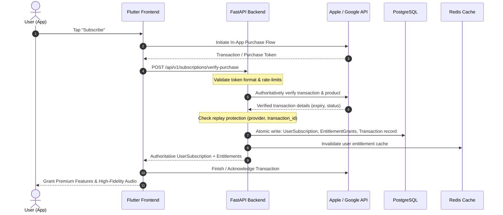

# Server-Authoritative Purchase Verification

## Overview

Hums enforces a strict **server-authoritative purchase verification** architecture. Mobile clients (iOS & Android) never make subscription decisions or grant entitlements directly. Client receipts, purchase tokens, and transaction identifiers submitted by Flutter are treated as unverified claims until authoritatively validated against Apple App Store or Google Play APIs on the FastAPI backend.



---

## 1. Verification Flow & Boundary

### A. Endpoint Specification

- **Path:** `POST /api/v1/subscriptions/verify-purchase`
- **Authentication:** Bearer JWT required (`CurrentUserDep`)
- **Rate Limit:** 10 requests / minute per IP and user
- **Request Body:**
  ```json
  {
    "provider": "apple",
    "product_id": "com.hums.yearly",
    "purchase_token": "signed_jws_or_token",
    "transaction_id": "tx_2000000123456789",
    "original_transaction_id": "tx_1000000123456789"
  }
  ```

### B. Validation Sequence

1. **Input Validation:** Pydantic v2 ensures valid provider (`apple`, `google`, `mock`), sanitized string lengths, and schema conformity.
2. **Catalog Validation:** Product ID is resolved against active `subscription_plans` in PostgreSQL.
3. **Provider Invocation:** The registered `BillingProvider` implementation verifies the transaction cryptographically or via upstream store REST API.
4. **Replay & Ownership Check:**
   - Database constraint check: Queries `subscription_transactions` for `(provider, transaction_id)`.
   - If already recorded:
     - If belonging to the **same user**: Idempotent replay, returns existing subscription.
     - If belonging to a **different user**: Returns `409 Conflict` (`CROSS_ACCOUNT_REPLAY`) to prevent receipt sharing or stolen token fraud.
5. **Persistence & Cache Eviction:**
   - Updates/inserts `user_subscriptions`.
   - Computes plan entitlements and persists `user_entitlement_grants`.
   - Records the audit row in `subscription_transactions`.
   - Flushes user's Redis entitlement cache key: `entitlements:user:{user_id}`.

---

## 2. Platform Providers

### Apple App Store (StoreKit 2 / App Store Server API)

- **Implementation:** `backend/app/services/billing/apple_provider.py`
- **Protocol:** App Store Server API v1 / v2 with JWS verification.
- **Authentication:** JSON Web Token (JWT) signed using Apple Developer Private Key (`.p8`), Key ID (`APPLE_KEY_ID`), Issuer ID (`APPLE_ISSUER_ID`), and Bundle ID (`com.hums.app`).
- **Verification API:** `GET https://api.storekit.itunes.apple.com/inApps/v1/transactions/{transactionId}`
- **Security:**
  - JWS decoded using Apple root certificates.
  - Expiration, bundle identifier, product ID, and revocation date validated.
  - Revoked transactions immediately mark subscription as `REVOKED`.

### Google Play (Google Play Developer API)

- **Implementation:** `backend/app/services/billing/google_provider.py`
- **Protocol:** Android Publisher API v3 (`purchases.subscriptionsv2`).
- **Authentication:** Google Service Account Private Key credentials (`GOOGLE_APPLICATION_CREDENTIALS`).
- **Verification API:** `GET https://androidpublisher.googleapis.com/androidpublisher/v3/applications/{packageName}/purchases/subscriptionsv2/tokens/{token}`
- **Lifecycle Handling:**
  - Validates `subscriptionState`: `SUBSCRIPTION_STATE_ACTIVE`, `SUBSCRIPTION_STATE_IN_GRACE_PERIOD`, `SUBSCRIPTION_STATE_CANCELED`, etc.
  - Supports account hold (`grace_period_end`).
  - Purchases must be acknowledged via `purchases.subscriptions.acknowledge` within 3 days to avoid auto-refund.

### Mock Provider (Local Development & CI)

- **Implementation:** `backend/app/services/billing/mock_provider.py`
- **Purpose:** Enables end-to-end testing, local development, and CI/CD pipelines without requiring Apple or Google developer accounts.
- **Safety Restriction:** Explicitly prohibited in production unless `ENVIRONMENT=development` or `ENVIRONMENT=test`. Production deployments verify real store credentials.

---

## 3. Replay Protection & Fraud Prevention

| Threat Vector | Mitigation Strategy | Result |
| :--- | :--- | :--- |
| **Transaction Replay (Same Account)** | Idempotency lookup in `subscription_transactions`. Existing active subscription returned without double-charging or corrupting records. | HTTP 200 OK |
| **Cross-Account Receipt Theft** | Query checks `transaction.user_id != current_user.id`. | HTTP 409 Conflict (`CROSS_ACCOUNT_REPLAY`) |
| **Tampered Product ID** | Server verifies provider's returned `provider_product_id` against requested plan code. | HTTP 400 Bad Request (`INVALID_PRODUCT`) |
| **Forged Store Tokens** | Cryptographic signature validation with Apple/Google public keys. | HTTP 402 / 400 Verification Failed |
| **Revoked / Refunded Tokens** | Expiration timestamp and revocation state checked on every verification. | HTTP 400 (`TRANSACTION_REVOKED`) |

---

## 4. Sensitive Data & Credential Isolation

1. **Private Keys:** Apple `.p8` private keys and Google Cloud service account JSON files reside strictly in backend environment secrets (`APPLE_PRIVATE_KEY`, `GOOGLE_SERVICE_ACCOUNT_JSON`).
2. **Zero Mobile Exposure:** Flutter never has access to store API secrets, server-to-server webhook shared secrets, or verification credentials.
3. **No Raw Token Logging:** In accordance with PCI-DSS & store security guidelines, purchase tokens and transaction receipts are excluded from stdout application logs.
