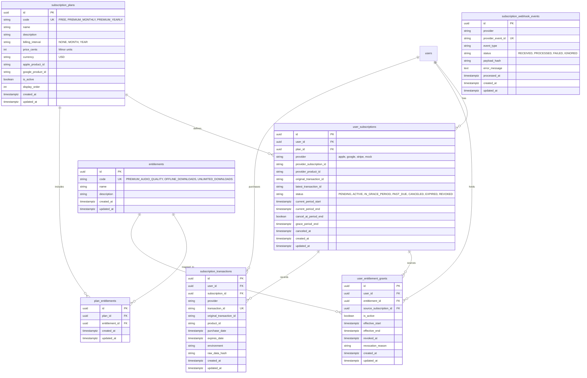

# Hums Subscription Architecture

**Version:** 1.0.0  
**Status:** Active  
**Author:** Principal Software Architect & Senior Backend Engineer  
**Date:** 2026-10-14  

---

## 1. Domain Overview & Decoupling Principle

The Hums monetization system is built on a strict architectural separation of concerns:

- **Subscription (`UserSubscription`)**: Describes the *commercial* relationship between a user and a commercial billing plan (provider, product identifier, billing interval, price, current period start/end, grace period, auto-renew cancellation flag, and authoritative lifecycle status).
- **Entitlement (`Entitlement` & `UserEntitlementGrant`)**: Describes what a user is *operationally permitted to access* in the platform (e.g., `PREMIUM_AUDIO_QUALITY`, `OFFLINE_DOWNLOADS`, `UNLIMITED_DOWNLOADS`).

This separation ensures:
1. Feature gating never inspects raw store receipt tokens, billing provider SKUs, or pricing data.
2. If billing plans change or new promotional bundles are created, feature code remains untouched.
3. Subscriptions in grace periods or canceled states retain active access until `current_period_end` or `grace_period_end` without complex conditional logic in API endpoints.
4. Access can be granted, adjusted, or revoked administratively without altering billing records.

---

## 2. Entity-Relationship Model

---

## 3. Subscription Lifecycle State Machine

| State | Definition | Entitlement Access Granted? | Next Valid States |
| :--- | :--- | :--- | :--- |
| `PENDING` | Purchase initiated on client, token submitted, awaiting authoritative verification. | **No** | `ACTIVE`, `CANCELED` |
| `ACTIVE` | Verified, currently active paid period. Auto-renew may or may not be enabled. | **Yes** | `ACTIVE` (renewed), `IN_GRACE_PERIOD`, `PAST_DUE`, `CANCELED`, `REVOKED` |
| `IN_GRACE_PERIOD` | Renewal payment failed, but store allows temporary grace period (e.g. 16 days Apple, 7-14 days Google). | **Yes** (until `grace_period_end`) | `ACTIVE` (recovered), `EXPIRED`, `REVOKED` |
| `PAST_DUE` | Renewal payment failed and no grace period configured; store billing retry in progress. | **No** | `ACTIVE` (recovered), `EXPIRED`, `REVOKED` |
| `CANCELED` | User cancelled auto-renewal. Remains in `CANCELED` state while still entitled until `current_period_end`. | **Yes** (until `current_period_end`) | `ACTIVE` (resubscribed), `EXPIRED`, `REVOKED` |
| `EXPIRED` | Paid period, retry periods, and grace periods have fully elapsed. | **No** | `ACTIVE` (resubscribed) |
| `REVOKED` | Transaction refunded, chargeback issued, or canceled for fraud by store provider. Access ceases immediately. | **No** | [*] Terminal |

---

## 4. Time and Monetary Standards

- **Timezone**: All timestamps are stored and computed in UTC (`DateTime(timezone=True)`).
- **Monetary Representation**: Stored as integer minor units (`price_cents`, e.g. `$9.99` = `999` cents) to avoid floating-point rounding errors.
- **Currency Code**: ISO 4217 uppercase 3-letter codes (default `"USD"`).
- **Grace Period Calculation**: Evaluated dynamically using `utcnow() <= grace_period_end`.
