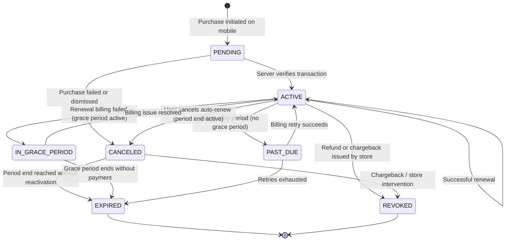

# Subscription & Premium Entitlements: Architecture Audit

**Status:** Completed  
**Author:** Principal Software Architect & Senior Mobile Engineer  
**Date:** 2026-10-14  
**Target Branch:** `feature/subscriptions-premium`

---

## 1. Executive Summary

This document establishes the architectural foundation for introducing production-grade **Subscriptions & Premium Entitlements** to the Hums audio platform. 

Hums currently operates with a robust suite of streaming, social, catalog search, offline download, and multi-tier audio transcode capabilities. However, monetization, commercial plan management, purchase verification, and server-authoritative entitlement evaluation do not yet exist in either the backend or mobile client.

This audit evaluates the current state of both the FastAPI backend and Flutter client, catalogs reusable assets, identifies architectural gaps, and defines the target domain models, state machine, platform billing boundaries, and feature-gating integration points.

---

## 2. Inventory of Existing Reusable Capabilities

| Subsystem | Existing Component | Reusability in Subscriptions Feature |
| :--- | :--- | :--- |
| **Authentication & Identity** | `app.core.dependencies.get_current_user`, `app.db.models.user.User` | Primary anchor for linking user subscriptions and entitlement grants. All user-specific subscription APIs use standard JWT bearer authentication. |
| **Audio Transcode Ladder** | `app.db.models.audio.AudioRendition`, `app.services.audio_service.AudioService` | Physical transcode assets exist for `HIGH` (192 kbps), `MEDIUM` (128 kbps), and `LOW` (64 kbps). Entitlement gating will restrict `HIGH` to `PREMIUM_AUDIO_QUALITY` entitlement holders while keeping `LOW` and `MEDIUM` available to Free users. |
| **Offline Downloads** | `AudioService.can_download_track()`, `GET /api/v1/audio/tracks/{id}/download` | Server-authoritative gating checkpoint. Currently allows track downloads if track is ready and owned. We integrate `EntitlementService` into `can_download_track()` to require the `OFFLINE_DOWNLOADS` entitlement. |
| **Rate Limiting** | `app.core.rate_limit.RateLimiter` | Sliding-window Redis rate limiter. Reused to protect `POST /api/v1/subscriptions/verify-purchase` and `POST /api/v1/subscriptions/restore` against brute-force replay attacks. |
| **Cache & Broker** | `Redis` (`redis://localhost:6379/0`), `Celery` | Redis provides fast in-memory entitlement caching (TTL 300s with explicit eviction on state changes). Celery provides asynchronous webhook processing and state reconciliation. |
| **Observability** | `app.core.metrics.MetricsRegistry`, `app.core.logging` | In-memory thread-safe metrics registry exporting Prometheus metrics with low-cardinality enforcement. Subscription verification, status transitions, and entitlement denials will be registered. |
| **Flutter Architecture** | Riverpod 2.6, Freezed, Dio 5.11, `go_router` 17.5 | Feature-first clean architecture (`features/subscriptions` with `data`, `domain`, `presentation`). Dio interceptor handles auth headers automatically. AppColors theme provides acoustic warmth palette (`#111113`, `#E58B44`). |

---

## 3. Missing Capabilities (Gaps to Implement)

1. **Domain Models & Database Persistence**:
   - `SubscriptionPlan`: Configurable commercial plan catalog (code, name, interval, active flag, display order, store product IDs).
   - `UserSubscription`: Verified user subscription lifecycle record with provider details, start/end dates, grace periods, cancellation flags, and authoritative status.
   - `Entitlement`: Abstract entitlement definitions (`PREMIUM_AUDIO_QUALITY`, `OFFLINE_DOWNLOADS`, `UNLIMITED_DOWNLOADS`).
   - `UserEntitlementGrant`: Materialized or computed active entitlement grants with effective date ranges, source subscription links, and revocation timestamps.
   - `SubscriptionWebhookEvent`: Idempotency tracking table for provider webhooks preventing replay and duplicate processing.

2. **Centralized Entitlement Service (`EntitlementService`)**:
   - Single authoritative backend service for resolving active entitlements for any user.
   - Request-time date validation ensuring expired subscriptions immediately lose premium access even before Celery cleanup tasks run.
   - Short-lived Redis caching with atomic cache invalidation upon purchase, renewal, cancellation, or revocation.

3. **Pluggable Billing Provider Verification (`BillingProvider`)**:
   - Provider interface defining `verify_purchase()` and `restore_purchases()`.
   - Apple App Store integration (StoreKit 2 / App Store Server API / JWS transaction verification boundary).
   - Google Play integration (Google Play Developer API / purchase token verification boundary).
   - Mock / Test Billing Provider for automated CI/CD and environments without live store credentials.
   - Transaction deduplication: Unique database constraints on `(provider, provider_transaction_id)` to prevent replay attacks and cross-account token reuse.

4. **Subscription API Endpoints**:
   - `GET /api/v1/plans`: Public/authenticated catalog of available plans and platform product IDs.
   - `GET /api/v1/subscriptions/me`: Current user subscription status, renewal date, and billing metadata.
   - `POST /api/v1/subscriptions/verify-purchase`: Authoritative purchase verification and entitlement issuance.
   - `POST /api/v1/subscriptions/restore`: Purchase restoration for reinstalled apps or device switches.
   - `GET /api/v1/entitlements/me`: Current active entitlements.
   - `POST /api/v1/webhooks/subscriptions/{provider}`: Asynchronous provider lifecycle events.

5. **Server-Side Feature Gating**:
   - In `AudioService.get_track_playback`: If `HIGH` quality is requested or selected, verify `PREMIUM_AUDIO_QUALITY`. If unentitled, fall back gracefully to `MEDIUM` (128 kbps) without erroring, preserving seamless playback for Free users.
   - In `AudioService.can_download_track`: Require `OFFLINE_DOWNLOADS` entitlement. Reject unauthorized download attempts with HTTP 403 Forbidden.

6. **Flutter Mobile Experience**:
   - `PremiumPlansScreen` (Paywall): Visual plan comparison (Monthly vs Yearly), feature matrix, billing legal disclosures, purchase triggers, restore button.
   - `SubscriptionStatusScreen`: Current plan, renewal status, cancellation indicator, active entitlements, App Store / Google Play management deep links.
   - Riverpod State Management: `SubscriptionNotifier`, `EntitlementsNotifier`, optimistic lock handling during pending transactions.
   - Account switching safeguards: Clear in-memory entitlement state upon sign-out to prevent credential or access leakage across accounts.

---

## 4. Proposed Subscription Lifecycle & State Machine

### State Definitions
- `PENDING`: Transaction submitted by client, awaiting backend verification with store provider.
- `ACTIVE`: Paid period currently valid; full entitlements granted.
- `IN_GRACE_PERIOD`: Payment failed on renewal, but store policy permits continued access until `grace_period_end`. Entitlements remain temporarily granted.
- `PAST_DUE`: Payment failed on renewal; store is retrying but no grace period applies. Entitlements suspended.
- `CANCELED`: User disabled auto-renew. The subscription remains active and entitlements are granted until `current_period_end`.
- `EXPIRED`: Paid period and grace period have ended without renewal. Entitlements revoked.
- `REVOKED`: Store canceled subscription due to refund, fraudulent purchase, or customer service action. Entitlements immediately revoked.

---

## 5. Platform-Specific Billing Considerations

### Apple App Store (iOS)
- **Framework**: StoreKit 2 (`StoreKit` in Flutter via platform channels or `in_app_purchase`).
- **Receipt / Transaction Format**: Signed JSON Web Signature (JWS) transaction token.
- **Server Verification**: App Store Server API (`/inApps/v1/transactions/{transactionId}`).
- **Environment**: Sandbox vs Production distinguished via JWS payload `environment` field.
- **Subscription Management**: Deep link to `https://apps.apple.com/account/subscriptions`.
- **Restoration**: StoreKit 2 automatically binds past purchases to the active Apple ID; verification sends the latest transaction JWS to the backend.

### Google Play Store (Android)
- **Framework**: Google Play Billing Library.
- **Receipt / Token Format**: `purchaseToken` + `productId` + `packageName`.
- **Server Verification**: Google Play Developer API (`purchases.subscriptionsv2.get`).
- **Acknowledgment**: Purchases must be acknowledged via backend (`purchases.subscriptions.acknowledge`) within 3 days or Google automatically refunds and revokes the purchase.
- **Subscription Management**: Deep link to `https://play.google.com/store/account/subscriptions?sku={sku}&package={package}`.

### Web / Alternate Providers (Stripe / Test)
- Configurable fallback provider interface for testing and environments where mobile store credentials are not configured.

---

## 6. Premium Features Actually Supported by Hums

In accordance with Mandatory Rule 7 ("Do not invent premium features that conflict with the existing PRD"), we limit premium entitlements strictly to existing capabilities:

1. **`PREMIUM_AUDIO_QUALITY`**:
   - Grants access to the `HIGH` (192 kbps AAC) audio rendition.
   - Free users have unrestricted streaming access to `LOW` (64 kbps) and `MEDIUM` (128 kbps).
   - If a Free user requests `HIGH`, the backend deterministically serves `MEDIUM` with fallback metadata.

2. **`OFFLINE_DOWNLOADS`**:
   - Enables saving tracks locally for offline playback via `GET /api/v1/audio/tracks/{id}/download`.
   - Free users attempting to download receive HTTP 403 Forbidden with prompt to upgrade.

3. **`UNLIMITED_DOWNLOADS`**:
   - Lifts any future storage or device download quantity limits.

---

## 7. Security and Migration Risks

1. **Transaction Replay Attacks**:
   - *Risk*: A malicious user captures a valid store transaction token and sends it repeatedly or from another user account.
   - *Mitigation*: Unique database constraint on `(provider, provider_transaction_id)`. If a transaction token is already recorded for another user, the verification request is rejected with HTTP 409 Conflict.

2. **Client-Side Tampering**:
   - *Risk*: Modifying local Flutter state to set `is_premium = true`.
   - *Mitigation*: Client-side flags have zero authorization authority. All audio renditions and download URLs require signed backend authorization with server-side entitlement checks on each request.

3. **Stale Cache / Clock Skew**:
   - *Risk*: Cached entitlement data outliving actual subscription validity.
   - *Mitigation*: Short cache TTL (300 seconds), explicit cache invalidation upon any webhook or purchase verification, and request-time UTC boundary checking (`current_period_end > utcnow()`).

4. **Sensitive Data Leakage**:
   - *Risk*: Logging raw JWS receipts, purchase tokens, or private payment secrets in application logs.
   - *Mitigation*: Strict masking and omission of receipt payloads in log formatters; credentials stored solely in environment variables.

---

## 8. Conclusion & Plan of Record

The audit confirms that Hums is fully prepared for a clean, decoupled Subscriptions & Entitlements layer. We proceed immediately with Phase Two: Domain Modeling and Database Migrations.
